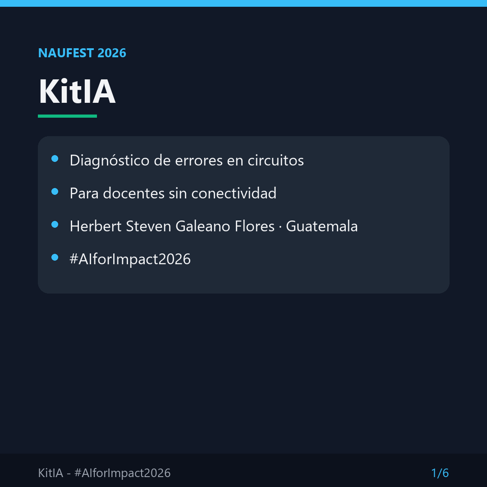
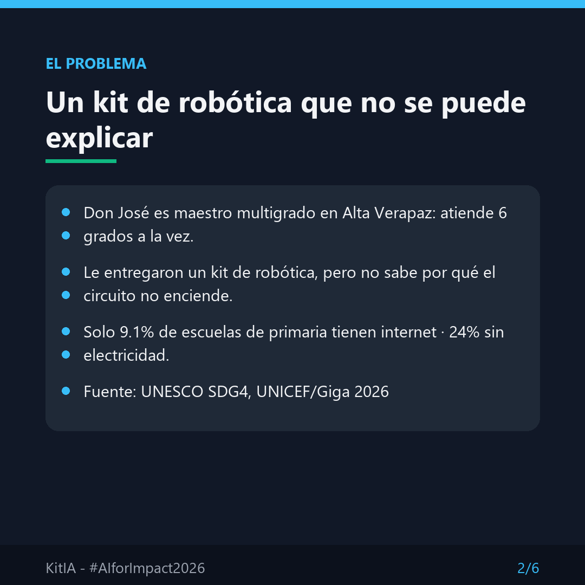
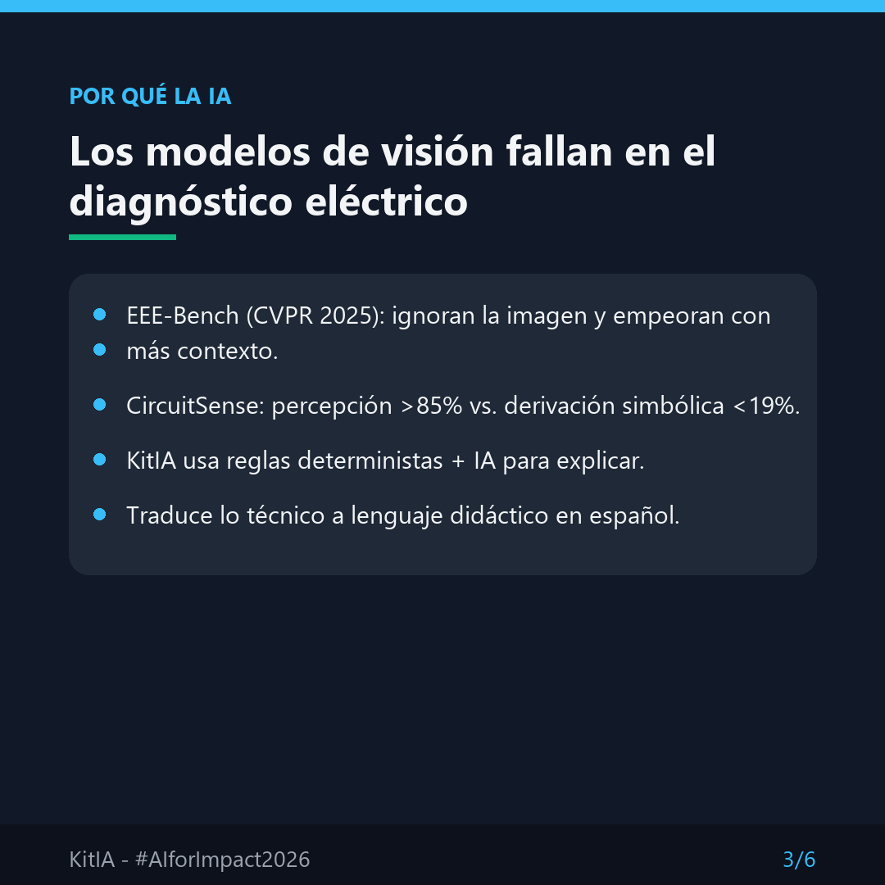
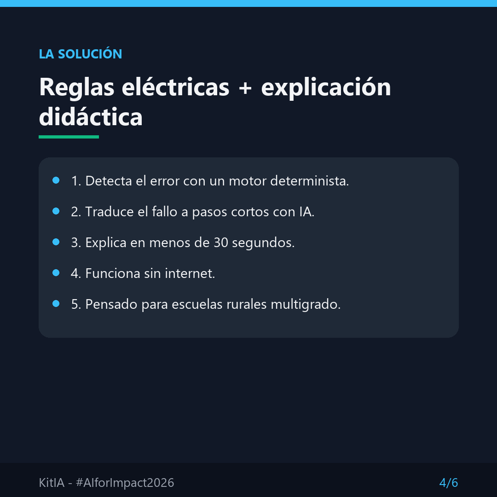
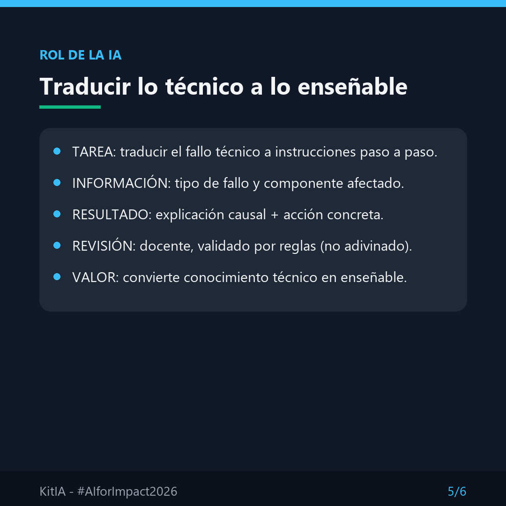
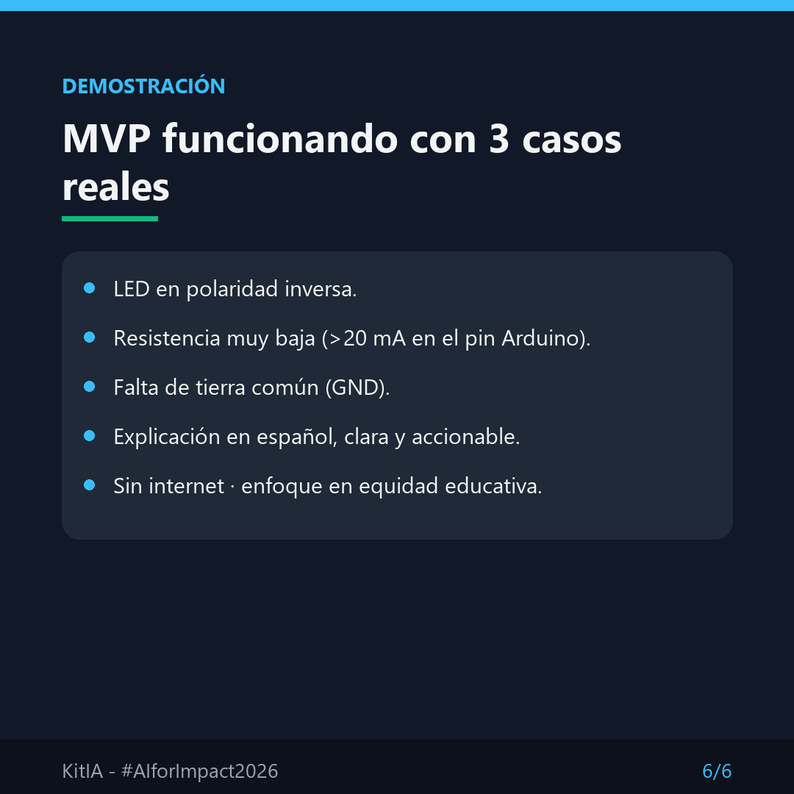

# KitIA - Diagnóstico de circuitos para docentes rurales

<p align="center">
  
</p>

<p align="center">
  
  
  
</p>
<p align="center">
  
  
</p>

## ¿Qué es KitIA?

KitIA es un asistente diseñado para docentes de escuelas públicas rurales multigrado que
reciben kits de robótica (Arduino, protoboard, LEDs) pero no tienen formación técnica para
diagnosticar por qué un circuito no enciende.

Traduce errores técnicos a instrucciones cortas, claras y en español, permitiendo corregir
el fallo en menos de 30 segundos, incluso sin internet.

## Problema que resuelve

- Solo el **9.1%** de escuelas de primaria en Guatemala tienen internet para uso pedagógico
  (UNESCO SDG4, 2026).
- **24%** de escuelas en Guatemala no tienen electricidad (UNICEF/Giga, 2026).
- Docentes multigrado atienden de 1° a 6° grado a la vez, sin capacitación técnica.
- Los kits de robótica quedan sin usar tras el primer "no funciona".

## Aporte a la sociedad

Democratiza el acceso a la robótica educativa para escuelas públicas rurales sin conectividad.
KitIA convierte conocimiento técnico en conocimiento enseñable, desarrolla capacidades locales
y evita el abandono temprano del estudiante.

---

# PARTE TÉCNICA

## Arquitectura

KitIA separa **detección** y **explicación**. Esa separación es el núcleo del diseño.

```
Circuito (netlist / datos de entrada)
        │
        ▼
┌───────────────────────────────┐
│  Motor determinista (reglas)  │  <- detecta el error con certeza
│  - Ley de Ohm                 │
│  - Polaridad LED              │
│  - Límite de pin Arduino      │
│  - GND común                  │
└───────────────────────────────┘
        │  (fallo identificado + componente afectado)
        ▼
┌───────────────────────────────┐
│  Capa de explicación (IA)     │  <- traduce a lenguaje didáctico
│  Explicación causal en español│
│  Acción concreta + tiempo     │
└───────────────────────────────┘
        │
        ▼
   Docente aplica la corrección
```

### ¿Por qué no se usa visión por cámara (VLM)?

Por diseño. La investigación de 2025-2026 demuestra que los modelos multimodales
**no son confiables** para diagnóstico eléctrico:

- **EEE-Bench (CVPR 2025):** los modelos ignoran la imagen y razonan sobre el texto;
  añadir contexto que contradice la imagen **empeora** el resultado.
- **CircuitSense:** percepción >85%, pero derivación simbólica <19%.
- **OmniSch (ECCV 2026):** parsing de layout y razonamiento de conectividad frágiles.

Por eso KitIA usa **reglas eléctricas deterministas** (ground truth) para detectar, y reserva
la IA para lo que sí sabe hacer bien: **traducir** el resultado técnico a lenguaje
comprensible. Esto además hace viable su uso **offline**.

## Módulos

| Archivo | Función |
|---|---|
| `kitia_mvp.py` | Motor de diagnóstico. Reglas + explicaciones en 3 casos. Sin dependencias externas. |
| `kitia_app.py` | Interfaz web con Streamlit. Presenta los diagnósticos al usuario. |
| `requirements.txt` | Dependencias: Pillow, Streamlit, pandas. |
| `carrusel/` | 6 slides en texto (contenido de la propuesta). |
| `carrusel_img/` | 6 slides renderizados en PNG 1080x1080 (entregable NAUFest). |
| `ejecutar.bat` | Launcher para Windows que activa el venv y arranca la app. |

## Casos de diagnóstico implementados (MVP)

| Clave interna | Síntoma | Detección (regla) | Corrección sugerida |
|---|---|---|---|
| `led_polaridad_inversa` | No enciende | Ánodo/cátodo invertidos | Invertir LED (pata larga hacia la resistencia) |
| `corriente_excesiva` | Parpadea / se calienta | I > 20 mA en pin del Arduino | Cambiar resistencia a 330 Ω |
| `sin_gnd_comun` | Sensor errático | Falta referencia GND común | Conectar GND del sensor al GND del Arduino |

## Ejemplo del motor de reglas (corriente excesiva)

Datos: alimentación lógica 5 V, LED rojo (caída ~1.7 V), resistencia R.

```
I = (Vcc - Vled) / R

R = 100 Ω  ->  I = (5 - 1.7) / 100 = 33 mA   ->  > 20 mA  ->  FALLO
R = 220 Ω  ->  I = (5 - 1.7) / 220 = 15 mA   ->  OK
R = 330 Ω  ->  I = (5 - 1.7) / 330 = 10 mA   ->  OK (recomendado)
```

Si I supera el máximo del pin (20 mA), el motor determinista marca el fallo y la capa de
explicación genera el mensaje para el docente.

---

# PARTE DE USUARIO

## Demo rápida (sin instalar nada)

```bash
python kitia_mvp.py
```

Muestra los 3 casos reales, cada uno con:

- **¿Qué pasa?** (síntoma)
- **¿Por qué?** (explicación causal)
- **¿Qué hacer?** (acción concreta)
- **Tiempo estimado** (segundos)

## App web completa (Streamlit)

Requiere Python 3.10+.

### Opción 1 - Windows (fácil)

Doble clic en `ejecutar.bat`.

### Opción 2 - Manual

```bash
python -m venv .venv
.venv\Scripts\activate        # Windows
# source .venv/bin/activate   # Linux/Mac
pip install -r requirements.txt
streamlit run kitia_app.py
```

Se abre en el navegador: `http://localhost:8501`

## Flujo para el docente

1. Observa el síntoma (LED no enciende / sensor falla).
2. Selecciona el caso en la app.
3. Lee la explicación causal en español.
4. Aplica la corrección paso a paso.
5. Comprueba el resultado.

No necesita internet ni conocimientos de electrónica.

## Rol concreto de la IA

La IA traduce el fallo detectado (por reglas eléctricas deterministas) a lenguaje didáctico y
accionable. Esto convierte conocimiento técnico en enseñable para docentes sin formación en
electrónica, y hace que KitIA sea **efectivo** (explicación causal, no binaria),
**viable** (funciona offline) y **accesible** (en español, pasos cortos).

---

## Entrega NAUFest 2026

- **Formato:** Diseño visual (6 imágenes 1080x1080).
- **Nombre del archivo:**
  `Herbert Steven Galeano Flores_Guatemala_Diseño visual_#AIforImpact2026`
- **Link de Drive:** permisos "Cualquiera con el enlace puede ver" (no editar).
- **Fecha límite:** 16 de octubre de 2026, subida por Moodle.
